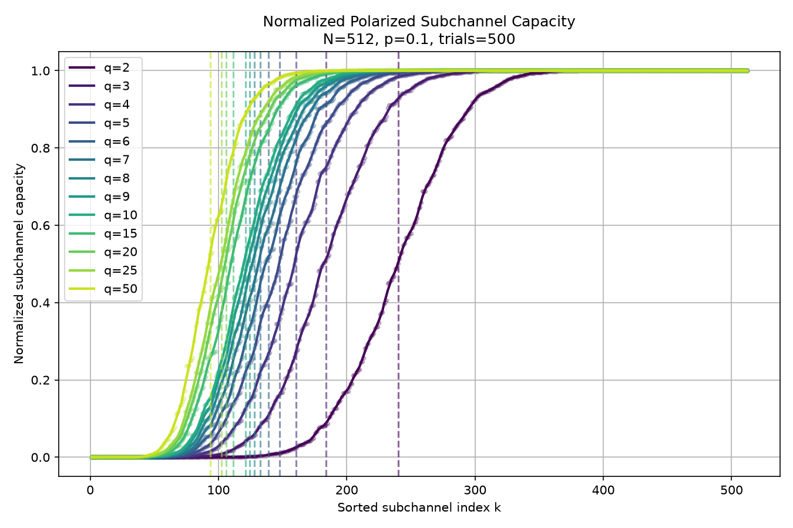
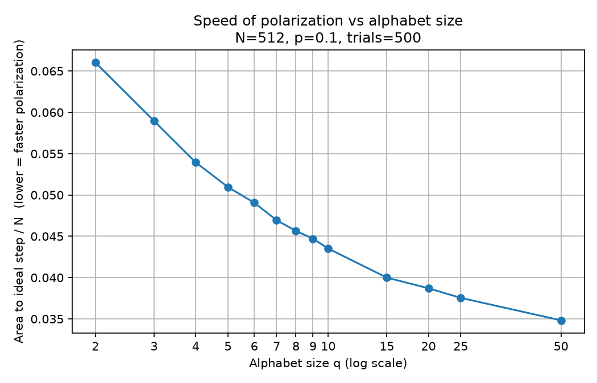

# Polar Codes for Higher-Order Alphabets

Simulating polar codes over q-ary symmetric channels to test whether channel
polarization persists at higher alphabet sizes.

**Author:** Jaden Zou · Cornell MEng ECE · Advisor: Prof. Aaron Wagner

Here is my Linkedin: [LinkedIn](https://www.linkedin.com/in/jadenzou55/)

## Summary

This project implements a full polar code simulator — encoder, successive
cancellation decoder, and sub-channel construction — starting from the binary
erasure channel (BEC), extending to the binary symmetric channel (BSC), and
finally generalizing to q-ary symmetric channels. The MEng report covers
q ∈ {2, 3, 5, 7}; follow-up work with my advisor extends this to
q ∈ {2–10, 15, 20, 25, 50} and adds a quantitative measure of the
**speed of polarization**.

The central question: does channel polarization — the phenomenon that makes
polar codes capacity-achieving in the binary case — persist as the alphabet
size grows? The answer is yes, and more: polarization actually **sharpens**
as q increases, an unexpected result. Measured as the area between the actual
capacity curve and an ideal step, the gap to perfect polarization shrinks by
about 47% from q = 2 to q = 50 at N = 512.

## Background

Polar codes (Arıkan, 2009) are the first provably capacity-achieving codes
with efficient O(N log N) encoding and decoding. They work by transforming N
uses of a channel into N synthetic sub-channels that "polarize" — some become
nearly perfect, the rest nearly useless. This project asks whether that
behavior holds beyond the binary case.

## Approach

`baseline/` holds the binary implementation: BEC first, where sub-channel
reliability can be computed analytically via the Bhattacharyya recursion,
then BSC, where no closed-form recursion exists so reliability is estimated
via Monte Carlo simulation instead.

`higher_alphabet/` generalizes the polar transform, channel model, and
decoder to q-ary symbols. Comparing raw block error rate across alphabet
sizes turned out to be misleading (larger q is unfairly favored), which
motivated switching to **normalized subchannel capacity** as the real
comparison metric — the result in `plot_normalized_capacity.py` is the main
finding of the project.

| File | What it does |
|---|---|
| `alphabet_bsc_fast.py` | q-ary polar transform (mod-q), q-ary symmetric channel, probability-vector SC decoder, Monte Carlo subchannel construction |
| `graph_alphabet.py` | Block error rate vs. number of information symbols K (q = 5) |
| `plot_normalized_capacity.py` | Normalized subchannel capacity for every q, plus the polarization-speed (area) measure |

## Results (beyond the report)

All figures and tables are in [`higher_alphabet/results/`](higher_alphabet/results/).

### Normalized subchannel capacity, q = 2 to 50



Each synthetic subchannel's capacity is estimated by Monte Carlo as
I(Uᵢ; Y, U₁…Uᵢ₋₁) = log₂q − H(Uᵢ | Y, U₁…Uᵢ₋₁) and divided by log₂q so every
alphabet sits on a [0, 1] scale. Dashed lines mark where a perfectly polarized
code would switch from 0 to 1: k = N·(1 − C/log₂q). As a sanity check, the
average subchannel capacity matches the theoretical channel capacity to within
0.0004 for every q.

### Speed of polarization

A perfectly polarized code is a step: capacity 0 up to the dashed line, 1
after it. The measure is the area between the actual (sorted) curve and that
step — area under the curve to the left of the step plus area above the curve
to the right — divided by N. Lower means faster polarization.



| q | normalized capacity | area / N |
|---:|---:|---:|
| 2 | 0.531 | 0.0660 |
| 3 | 0.641 | 0.0590 |
| 5 | 0.712 | 0.0510 |
| 7 | 0.741 | 0.0469 |
| 10 | 0.763 | 0.0435 |
| 20 | 0.793 | 0.0387 |
| 50 | 0.817 | 0.0348 |

Full table: [`area_summary_N512_p0.1_trials500.md`](higher_alphabet/results/area_summary_N512_p0.1_trials500.md).
The area decreases monotonically with q, including for non-prime q (4, 6, 8, 9,
10, 15, 20, 25, 50), even though the theory for the mod-q kernel only
guarantees full polarization for prime q. These are finite-length numerical
results (N = 512, p = 0.1, 500 trials per subchannel), not a proof.

### Block error rate (q = 5)

[`bler_vs_K_N256_q5_p0.1_trials200.png`](higher_alphabet/results/bler_vs_K_N256_q5_p0.1_trials200.png)
reproduces report Figure 5: block error rate stays near 0 until K ≈ 125 and
crosses 0.5 at K = 157 (theoretical limit ≈ 204 symbols at N = 256).

## Running it

```bash
pip install -r requirements.txt
cd higher_alphabet
python plot_normalized_capacity.py   # loads capacity_cache/ instantly; set FORCE_RECOMPUTE = True to rerun (~4 min on 14 cores)
python graph_alphabet.py             # BLER vs K for q = 5 (~25 min)
```

Each script writes its figures and tables to `higher_alphabet/results/`.

## Full report and poster

`jz2396_MEng_Project_Report.pdf` is the complete written report submitted for
Cornell's MEng program, and `jadenpolarposter.pdf` is the accompanying
presentation poster. The report is organized by semester rather than by this
repo's layout, so this README is the better starting point if you just want
the gist of the project.

## Tech stack

Python, NumPy, Matplotlib

## Note on the code

Some files still contain leftover print statements and debug output from
development — these were left in in case they're useful for
tracing through the pipeline again, and don't affect correctness. Everything
runs fine as-is.

`plot_normalized_capacity.py` evaluates all Monte Carlo trials for a
subchannel at once with numpy and spreads subchannels across CPU cores. The
batched functions are checked against the original one-trial-at-a-time
version (`estimate_subchannel_prob_vector`) and agree to ~1e-16.
